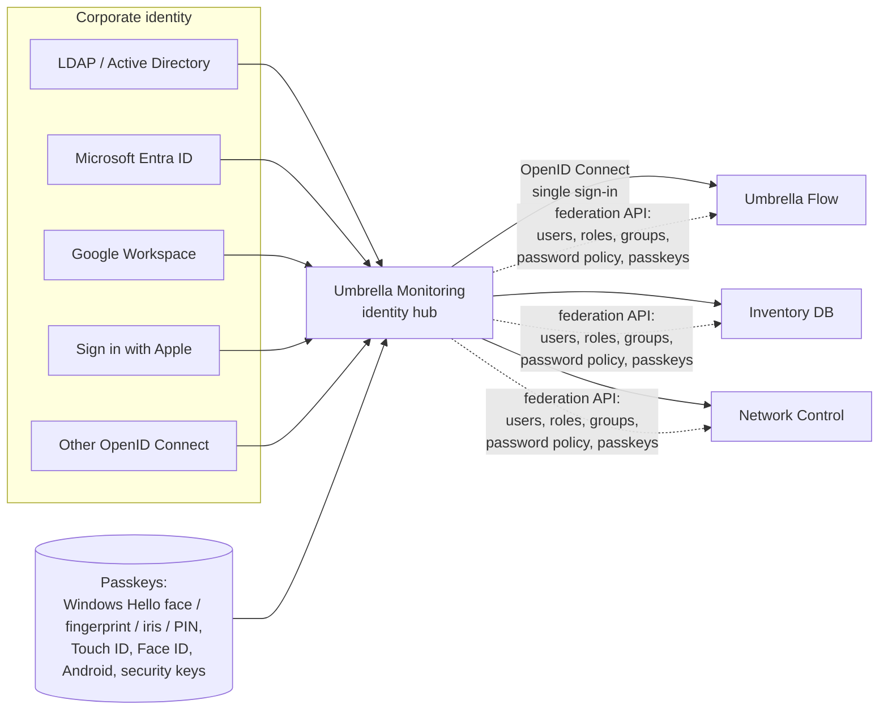

# Umbrella Identity: single sign-in, passkeys and user synchronization

Umbrella Monitoring is the identity hub of the Umbrella family. The same document is kept in every application of
the family (Umbrella Monitoring, Umbrella Flow, Inventory DB, Network Control); the hub implements the
**hub** sections, the other applications — the **member** sections.



## What every application supports

| Sign-in method | Where it is configured | How members get it |
|---|---|---|
| Local account with a password policy | each application (members: policy from the hub) | the policy is synchronized |
| **Passkey** (WebAuthn / FIDO2): Windows Hello (face, fingerprint, iris, PIN), Touch ID / Face ID, Android biometrics, FIDO2 security keys | each application, users register keys in their profile | the hub's passkeys are synchronized when the applications share a passkey domain; otherwise "Sign in with a passkey" goes through the hub |
| LDAP / Active Directory | each application or the hub | through the hub ("Sign in with Active Directory") |
| Microsoft Entra ID | each application or the hub | through the hub |
| Google (Workspace) | each application or the hub | through the hub |
| Sign in with Apple | each application or the hub | through the hub |
| Any OpenID Connect provider (Keycloak, ADFS, Okta, Authentik…) | each application or the hub | through the hub |
| **Umbrella single sign-in** | members | — |

A member can run on its own (standalone: its own providers and policy) or join the hub (federated: one place to
configure providers, users, roles and the policy for the whole family). Local administrator accounts always keep
working, so a broken connection never locks the administrators out.

## Corporate defaults

- Passkeys require **user verification** (biometrics or a PIN): a passkey sign-in is two-factor by itself
  (`amr = ["hwk", "user"]`, NIST SP 800-63B AAL2), phishing-resistant and bound to the domain.
- External providers create accounts only for **allowed e-mail domains** (Google `hd`, e-mail domain for Apple and
  OpenID Connect) and, when enabled, only for people who already have an account.
- Password policy (NIST SP 800-63B / CIS): minimum length (12 by default), character classes, allowed alphabets,
  **blocking of common and breached-style passwords**, **password history**, maximum age with a warning, **account
  lockout** after failed attempts.
- Secrets (client secrets, Apple keys, signing keys, synchronization tokens) are stored only in OpenBao; APIs return
  `*_set` flags, never the values.
- Every sign-in, failed sign-in, passkey registration and removal, provider change, application connection and
  synchronization is written to the audit log.
- Deprovisioning: an account disabled or deleted in the hub (or in the directory behind it) is disabled in every
  member at the next synchronization (at most 5 minutes) and its sessions are revoked.

## Password policy

The policy object is identical in all applications and is copied from the hub as is:

| Field | Range | Default | Meaning |
|---|---|---|---|
| `min_length` | 8–128 | 12 | minimum number of characters |
| `require_digits`, `min_digits` | 1–16 | true, 1 | digits |
| `require_special`, `min_special` | 1–16 | true, 1 | punctuation and symbols |
| `require_mixed_case` | | true | upper- and lower-case letters |
| `letters` | `latin`, `cyrillic`, `latin_cyrillic`, `any` | `latin` | allowed alphabets |
| `max_age_days`, `warn_days` | 0–3650, 0–90 | 0, 0 | expiry (0 = never) and the warning before it |
| `history_count` | 0–24 | 5 | the new password must differ from the last N |
| `block_common` | | true | reject the most common passwords, keyboard sequences and passwords made of the user name |
| `lockout_attempts` | 0 or 3–100 | 10 | failed sign-ins in a row that lock the account (0 = off) |
| `lockout_minutes` | 1–1440 | 15 | how long the lock lasts |

Violations returned by the APIs: `length`, `digits`, `special`, `mixed_case`, `letters`, `username`, `control`,
`common`, `history`.

## Hub (Umbrella Monitoring)

### Connected applications

*Settings → Sign-in and Umbrella Identity → Connected applications → Connect an application* has three steps:

1. **Application** — the type (Network Control, Umbrella Flow, Inventory DB or another OpenID Connect application),
   its name and address (`https://…`). The redirect address is filled in from the type
   (`<address>/api/auth/umbrella/callback`).
2. **Access** — who may sign in: everybody, members of chosen roles, or members of chosen directory groups; whether
   the application receives passkeys.
3. **Connection key** — Umbrella creates the OpenID Connect client (client ID and secret) and the application's
   synchronization token and shows the **connection key** once. The secret and the token are kept only as keyed
   hashes (HMAC-SHA256, the key in OpenBao), like API tokens. The key is pasted into the member in one field.

The connection key is `umbid1.` followed by base64url of the JSON
`{"hub": "https://umbrella.example.com", "client_id": "…", "client_secret": "…", "token": "umb_…"}`.

The application card shows the last synchronization (time and address of the last use of its token), lets the
administrator change access, issue a new key (the old secret and token stop working) or disconnect the application.

### OpenID Connect provider

| Endpoint | Description |
|---|---|
| `GET /.well-known/openid-configuration` | discovery |
| `GET /oauth2/jwks` | public signing keys (RS256; the private key is in OpenBao, `identity/signing`) |
| `GET /oauth2/authorize` | authorization code flow; `client_id`, exact `redirect_uri`, `response_type=code`, `scope` (`openid profile email groups`), `state`, `nonce`, `code_challenge` with `code_challenge_method=S256` (required), optional `prompt=login`, `login_hint` and `idp_hint` |
| `POST /oauth2/token` | `grant_type=authorization_code`, client authentication `client_secret_basic` or `client_secret_post`, `code_verifier`; returns `id_token`, `access_token` (opaque, 10 minutes), `token_type`, `expires_in` |
| `GET /oauth2/userinfo` | the claims of the access token |
| `GET /oauth2/logout` | ends the hub session; `post_logout_redirect_uri` must start with the address of a connected application |

The hub keeps the request and sends the browser to its page `/sso?request=<id>`: a signed-in person goes straight
back to the application with a code; others sign in first (with any method of the hub) and then go back. The person
must be allowed to use the application (access by everybody, by roles or by directory groups), otherwise the page
says so and the sign-in is written to the audit log as refused.

`idp_hint` makes the hub start a method at once instead of showing its sign-in page: `local`, `passkey`, `ldap`,
`entra`, `google`, `apple`, `oidc`. Codes live 60 seconds and are single-use; a code issued to one client cannot be
redeemed by another.

ID token claims: `iss`, `sub` (the hub user ID), `aud`, `exp` (5 minutes), `iat`, `auth_time`, `nonce`, `amr`
(`pwd`, `hwk`+`user` for a passkey, `fed` for an external provider), `preferred_username`, `name`, `given_name`,
`family_name`, `email`, `groups` (directory groups), `umbrella_role` (`{"id", "name"}`), `teams` (team names).

### Settings and permissions

Everything is on *Settings → Sign-in and Umbrella Identity* (permission page `settings.identity`: view, edit):
the setup guide (public address → password policy → passkeys → corporate sign-in → applications), the passkey
domain, Google / Apple / OpenID Connect providers and the connected applications. Users add passkeys in their
profile; an administrator with `users:lock` removes the passkeys of a lost device in the user dialog.

| API | Permission |
|---|---|
| `GET/PUT /api/settings/passkeys` | `settings.identity:view` / `edit` |
| `GET /api/settings/providers`, `PUT /api/settings/providers/{google,apple,oidc}` | `settings.identity:view` / `edit` |
| `GET/POST /api/identity/applications`, `PUT/DELETE /api/identity/applications/{id}`, `POST …/{id}/key` | `settings.identity:view` / `edit` |
| `POST /api/auth/passkey/begin`, `POST /api/auth/passkey/finish` | public (rate-limited per address) |
| `GET /api/auth/me/passkeys`, `POST …/begin`, `POST …/finish`, `PATCH/DELETE …/{id}` | signed in |
| `GET /api/users/{id}/passkeys`, `DELETE /api/users/{id}/passkeys/{id or *}` | `users:view` / `users:lock` |
| `GET /api/auth/sso/{google,apple,oidc}/start`, `GET/POST …/callback` | public |

### Federation API

Called by members with the application's synchronization token (`Authorization: Bearer umb_…`). A new connection
key revokes the old token and client secret at once.
Both answers carry an `ETag`; a request with `If-None-Match` returns `304 Not Modified` when nothing changed.

`GET /api/identity/v1/config`

```json
{
  "version": 1,
  "issuer": "https://umbrella.example.com",
  "application": {"id": "APP-1", "name": "Network Control", "sync_passkeys": true},
  "password_policy": {"min_length": 12, "require_digits": true, "min_digits": 1, "require_special": true,
                      "min_special": 1, "require_mixed_case": true, "letters": "latin", "max_age_days": 0,
                      "warn_days": 0, "history_count": 5, "block_common": true, "lockout_attempts": 10,
                      "lockout_minutes": 15},
  "passkeys": {"enabled": true, "rp_id": "example.com"},
  "methods": [{"id": "passkey", "title": "Passkey"}, {"id": "ldap", "title": "Active Directory"},
              {"id": "entra", "title": "Microsoft Entra ID"}, {"id": "google", "title": "Google"},
              {"id": "apple", "title": "Apple"}, {"id": "oidc", "title": "Keycloak"}, {"id": "local", "title": "Umbrella account"}],
  "updated_at": "2026-10-14T12:00:00Z"
}
```

`GET /api/identity/v1/users` — every person allowed to sign in to the application, and the disabled ones (so members
can disable them):

```json
{
  "users": [{
    "id": "USR-12", "username": "ivanov", "email": "ivanov@example.com", "name": "Ivanov Ivan",
    "first_name": "Ivan", "last_name": "Ivanov", "source": "ldap", "disabled": false,
    "role": {"id": "ROLE-3", "name": "On-call engineer"}, "admin": false,
    "groups": ["cn=noc,ou=groups,dc=example,dc=com"], "teams": ["NOC"],
    "passkeys": [{"id": "PK-4", "name": "Windows Hello", "credential_id": "base64url", "public_key": "base64url COSE key", "user_handle": "base64url",
                  "sign_count": 12, "aaguid": "08987058-cadc-4b81-b6e1-30de50dcbe96", "transports": ["internal"],
                  "backup_eligible": false, "created_at": "2026-10-01T09:00:00Z"}],
    "updated_at": "2026-10-14T11:58:00Z"
  }],
  "generated_at": "2026-10-14T12:00:00Z"
}
```

Passkeys are included only when the application has "Receive passkeys" on and the hub has a passkey domain.

## Members (Umbrella Flow, Inventory DB, Network Control)

### Connecting

The single sign-in settings page of the member (Umbrella Flow: *Settings → Sign-in*; Inventory DB and Network
Control: *Settings → Single sign-in*) connects in three steps:

1. **Connection key** — paste the key from the hub; the member checks the hub, the client secret and the token.
2. **Roles** — how hub roles and directory groups become the member's roles (a table "hub role or group →
   role"), the role of people nobody mapped (or "no access"), whether existing local accounts with the same user
   name are linked to the hub.
3. **Options** — single sign-in on the sign-in page, user synchronization, password policy from the hub, passkeys
   from the hub. Everything is on by default.

The client secret and the token are written to the member's OpenBao.

### Single sign-in

The sign-in page shows "Sign in with Umbrella" and a button for every method of the hub's `methods` list
("Windows Hello / passkey", "Active Directory", "Microsoft", "Google", "Apple"…). A button opens
`/api/auth/umbrella/start?method=<id>`, which redirects to the hub's `/oauth2/authorize` with PKCE, `state`,
`nonce` and `idp_hint=<id>`; `/api/auth/umbrella/callback` redeems the code, verifies the ID token (signature from
the hub's JWKS, issuer, audience, expiry, nonce) and signs the person in to the account bound to `sub`.

### Synchronization

Every 5 minutes (and with "Synchronize now") the member reads `config` and `users`:

- creates accounts for new people (source `umbrella`, bound to the hub `id`), updates names, e-mails and roles,
  disables accounts that are disabled or missing in the hub and revokes their sessions;
- an existing local account with the same user name is linked only when "Link local accounts" is on;
- replaces the local password policy with the hub's (the policy page becomes read-only);
- stores the hub's passkeys for the synchronized accounts when the member's address is inside the hub's passkey
  domain (`rp_id` equals the member's host name or is a parent domain of it), so a passkey created once works on
  every application; otherwise the passkey button signs in through the hub.

Role mapping: the first matching row of the table wins (a row matches the hub role name or one of the person's
directory groups); a hub administrator becomes a member administrator unless a row says otherwise.

The settings page shows the last synchronization, the numbers of created, updated and disabled accounts, conflicts
(a local account with the same name that is not linked) and the last error.
