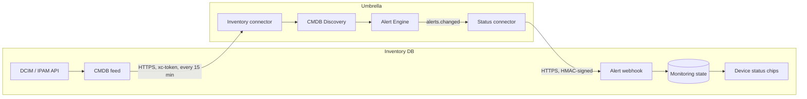
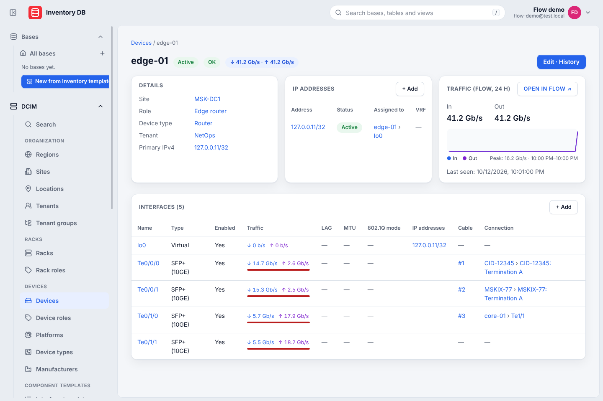

# Integrations

Inventory DB integrates with [Umbrella monitoring](#umbrella-monitoring) (CMDB feed and alert states) and with
[Umbrella Flow](#umbrella-flow) (network traffic on DCIM / IPAM pages).

## Umbrella monitoring

[Umbrella](https://github.com/sbrw-evc/Umbrella-Monitoring) is the umbrella monitoring app: it collects
events from every monitoring system, deduplicates them into alerts, builds a CMDB map and pages through
PagerDuty. Inventory DB and Umbrella work together in two directions:

| Direction | What | How |
|---|---|---|
| Inventory DB → Umbrella | Sites, racks and devices become configuration items (CIs) of Umbrella's CMDB map, with names, IPs, DNS names and serials to match events against, and `located_in` / `connected_to` relations for impact analysis | Umbrella's inventory connector pulls `GET /api/v1/integrations/:id/umbrella/ci` every 15 minutes with an API token (flow П-06 in Umbrella's docs) |
| Umbrella → Inventory DB | Alert state on each device: worst open severity, alert titles, links to the Umbrella incident and its Grafana dashboard | Umbrella POSTs alert changes to `POST /api/v1/integrations/:id/umbrella/alerts`, signed with the integration secret |



### Set up

1. In Inventory DB create an integration: `POST /api/v1/integrations`
   `{"kind":"umbrella","title":"Umbrella prod","umbrellaUrl":"https://umbrella.corp","inventoryUrl":"https://inventory.corp"}`.
   Save the returned `secret`; it is shown once (`POST /integrations/:id/rotate-secret` issues a new one).
   The **Integrations** page in the web UI does the same and shows the feed and webhook URLs to paste into Umbrella,
   the time of the last full feed read and of the last signed alert, and alerts that matched no device.
2. Create an API token for a read-only service user (`POST /api/v1/tokens`). The feed contains what
   that user can read through the DCIM/IPAM API.
3. In Umbrella, put the token and the secret into OpenBao and build two connectors in the low-code
   builder (step-by-step in Umbrella's `integrations/inventory-db.md`):
   - **Inventory connector**: schedule trigger 15 min → HTTP REST `GET {inventory}/api/v1/integrations/{id}/umbrella/ci`
     with header `xc-token`, paging by `offset` until `next_offset` is null → output "inventory object".
     Mark Inventory DB as a trusted discovery source so additions apply without review.
   - **Status connector**: subscription to `alerts.changed`, filter "CI has a `inventory-db:` source_ref,
     or is a host", HTTP REST `POST {inventory}/api/v1/integrations/{id}/umbrella/alerts` with the
     signature headers below.

### CMDB feed

`GET /api/v1/integrations/:id/umbrella/ci?offset=0&limit=1000` returns a full snapshot; Umbrella's CMDB
Discovery compares consecutive snapshots, so deletions show up as removals for review there.

```json
{
  "source": "inventory-db", "integration_id": "int_…", "generated_at": "2026-10-08T14:00:00.000Z",
  "count": 4, "offset": 0, "next_offset": null,
  "items": [{
    "source_ref": "inventory-db:dcim.device:100",
    "type": "device", "name": "App-01", "status": "active", "monitored": true,
    "identities": { "hostname": "app-01", "fqdn": ["app-01.corp.example"], "ip": ["10.0.0.5"], "serial": "SN100" },
    "logical_group": null,
    "attributes": { "role": "Server", "manufacturer": "Dell", "model": "R650", "site": "DC1", "rack": "R01", "tags": ["prod"] },
    "relations": [
      { "type": "located_in", "direction": "out", "target_ref": "inventory-db:dcim.rack:10" },
      { "type": "connected_to", "direction": "out", "target_ref": "inventory-db:dcim.device:101", "via": "cable 5" }
    ],
    "url": "https://inventory.corp/dcim/devices/100",
    "last_updated": "2026-10-01T10:00:00Z"
  }]
}
```

- `source_ref` is stable; Umbrella keeps it in the CI's `source_refs` and sends it back with alerts.
- `monitored` is false for `planned`, `offline`, `inventory` and `decommissioning` objects so Umbrella can
  suppress paging for them.
- `logical_group` is the virtual chassis or cluster, used by Umbrella to glue members together.
- IPs come from IPAM addresses assigned to the device's interfaces plus its primary and OOB IPs; FQDNs
  from the addresses' DNS names.

### Alert webhook

`POST /api/v1/integrations/:id/umbrella/alerts`, body is one event or an array of up to 500:

```json
{
  "alert_id": "8f1c…", "status": "open", "severity": "critical",
  "title": "Host down: app-01", "signal": "use.host.availability",
  "ci": { "source_refs": ["inventory-db:dcim.device:100"], "name": "app-01",
          "identities": { "hostname": "app-01", "fqdn": "app-01.corp.example", "ip": "10.0.0.5" } },
  "links": { "incident": "https://umbrella.corp/incidents/8f1c…", "grafana": "https://umbrella.corp/go/incidents/8f1c…/grafana" },
  "updated_at": "2026-10-08T14:00:00Z"
}
```

- `status`: `open`, `acknowledged`, `resolved`, `closed`; `severity`: `critical`, `error`, `warning`, `info`.
- **Signature.** `x-umbrella-timestamp: <unix seconds>` and
  `x-umbrella-signature: v1=<hex HMAC-SHA256(secret, "<timestamp>.<raw body>")>`. Requests older than
  5 minutes are rejected. During rotation the header may carry two comma-separated signatures.
- **Matching.** An `inventory-db:` source_ref wins. Otherwise the CI's hostname, FQDN (and its short
  name), name and IPs are matched case-insensitively against devices. Alerts that match nothing are
  listed at `GET /integrations/:id/umbrella/unmatched`.
- **Ordering.** Updates are idempotent by `alert_id`; an update with an older `updated_at` than the stored
  one is ignored, so retries and out-of-order deliveries are safe. Resolved alerts are kept 30 days.

### Showing status

`GET /api/v1/integrations/umbrella/status?object_type=dcim.device&ids=100,101` returns, for each id, the
`state` (`ok`, `info`, `warning`, `error`, `critical`) and the active alerts, worst first.
`GET /api/v1/integrations/umbrella/status/dcim.device/100` adds the last 50 alerts as `history`. Device
lists show `state` as a status chip using the design tokens (`--critical-*`, `--error-*`, …), and the
device side panel lists the alerts with links to the incident and its Grafana dashboard.

### Security
- The signing secret is stored encrypted (AES-256-GCM) under `INTEGRATION_KEY` (falls back to `JWT_SECRET`).
- The webhook answers 401 for unknown, inactive and badly signed requests alike, so ids can't be probed.
- Matching by hostname/IP reads the inventory as the integration's creator, cached for 60 seconds.

## Umbrella Flow

[Umbrella Flow](https://github.com/sbrw-evc/Network) analyses NetFlow / IPFIX / sFlow. Inventory DB implements its side
of the cross-application contract, [Network `docs/integrations.md`](https://github.com/sbrw-evc/Network/blob/main/docs/integrations.md)
§1 (API tokens) and §2 (Flow ↔ Inventory DB):

| Direction | What | How |
|---|---|---|
| Inventory DB → Flow | Traffic shown on devices, interfaces, circuits and prefixes | Server-side calls to Flow's `/api/integrations/inventory-db/status` and `/prefix-addresses` with the Flow API token (§2.1) |
| Inventory DB → Flow | "Something changed, sync early" | Signed `POST {flowUrl}/api/integrations/inventory-db/hook` after DCIM / IPAM / circuits changes (§2.2) |
| Flow → Inventory DB | Inventory snapshot, "Create in Inventory DB" | The NetBox-compatible API with an `xc-token` / `Authorization: Bearer` token of a read-only (and optionally an editor) user (§2.3) |

### Set up

1. In Flow, create an API token with `integrations.inventory:read`.
2. In Inventory DB (DCIM/IPAM admins only), **Integrations → Connect Umbrella Flow**, or
   `POST /api/v1/integrations` `{"kind":"flow","title":"Flow","flowUrl":"https://flow.corp","flowToken":"flow_…"}`.
   Copy the returned `secret` into Flow (it is shown once; `POST /integrations/:id/rotate-secret` issues a new one).
   `PATCH /integrations/:id` changes `flowUrl` or replaces the token (`flowToken`); the token is never returned.
3. Creating the integration adds the custom field `snmp_index` (integer, `dcim.interface`) unless it exists; fill it
   with the interfaces' ifIndex so Flow can match flow records to interfaces.
4. For Flow's inventory sync, create an API token of a read-only user (`POST /api/v1/tokens`) and, for
   "Create in Inventory DB", optionally one of an editor user; both go into Flow's OpenBao.

### Traffic on DCIM / IPAM pages

The browser never talks to Flow. The UI calls two proxy endpoints (any signed-in user with DCIM/IPAM read access):

- `GET /api/v1/integrations/flow/status?object_type=dcim.device|dcim.interface|circuits.circuit&ids=1,2[&window=24h]`
  returns Flow's answer (§2.1) for the ids asked for (at most 1000).
- `GET /api/v1/integrations/flow/prefix-addresses?prefix=10.0.0.0/24[&vrf=<name>][&window=24h]` returns the
  addresses Flow saw in the prefix. `in_ipam` and `ip_address_id` are recomputed from Inventory DB's own IPAM, so an
  address created a moment ago shows as in IPAM at once.

The oldest active `flow` integration answers. Answers are cached for 60 s per query (failures for 15 s); Flow gets 5 s
to answer. Without an active integration the endpoints answer **404**, when Flow fails, times out or answers badly
**502** (a Flow 404 stays 404), and the UI then hides everything, like the Umbrella status chips:

- **Devices list** and **interfaces list**: a *Traffic* column with in/out rates and a utilisation bar.
- **Device page**: a chip with in/out next to the title, and a card with rates, utilisation, the 24 h in/out
  sparkline and **Open in Flow**; the device's interface rows get the Traffic column.
- **Interface** (side panel): the same card.
- **Circuit page**: the card plus the monthly 95th percentile against the commit, and an *Over commit* /
  *Within commit* chip next to the title.
- **Prefix page**: *Active addresses (Flow)* with bytes, flows, last seen and *In IPAM*; rows not in IPAM have
  **Create IP address**, which opens the usual IP address form with the address (prefix length of the prefix), VRF,
  `active` status and "Discovered by Umbrella Flow".

### Change notifications

Every committed DCIM / IPAM / circuits change (`netboxEvents`) is queued for each active `flow` integration. A queue is
sent at most once every 5 seconds per integration, so bulk edits and imports become one request; an object changed
several times appears once (created + updated stays `object.created`, a deletion wins), at most 1000 events per request.

```http
POST {flowUrl}/api/integrations/inventory-db/hook
content-type: application/json
x-inventory-timestamp: 1760266000
x-inventory-signature: v1=<hex HMAC-SHA256(secret, "<timestamp>.<raw body>")>

{"integration_id":"int_…","events":[{"event":"object.updated","object_type":"dcim.interface","id":12}],"sent_at":"2026-10-12T10:46:00.000Z"}
```

- Network errors, timeouts (10 s), 408, 429 and 5xx are retried after 5 s, 30 s and 2 min; other 4xx (e.g. a wrong
  secret) are not retried. Flow also syncs on its own schedule, so a lost notification only delays a sync.
- After a secret rotation the signature header carries two comma-separated signatures (new and old secret) for 24 hours.
- The Integrations page shows the time and result of the last delivery (events, attempts, HTTP status or error).

### Secrets

The Flow API token and the hook signing secret are stored together in the secret store at `integrations/<id>`
(`flow_token`, `signing_secret`, and `previous_signing_secret` during a rotation): in OpenBao when it is configured,
otherwise AES-256-GCM encrypted in PostgreSQL (`nc_secrets`) and moved to OpenBao once it is configured — see
[settings.md](settings.md#secrets-and-openbao). The API and the UI only show whether a token is set.

Flow is an internal service, so its URL may be a private address (unlike outgoing webhooks, there is no
`WEBHOOK_ALLOW_PRIVATE` check); that is why only DCIM/IPAM admins can create `flow` integrations.

### Verified end to end

With Flow, Umbrella, OpenBao and PostgreSQL on one host (the demo network seeded by Flow's `seed-demo.mjs`), wired only
through the APIs above: device, interface and circuit traffic and the active addresses of a prefix came through the
proxy endpoints; renaming an interface description sent a signed notification Flow accepted (202) five seconds later,
and Flow's next flows carried the new description.


